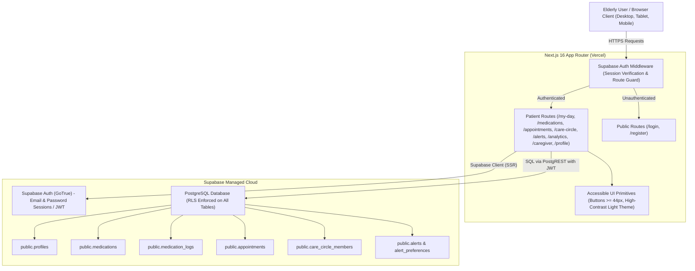
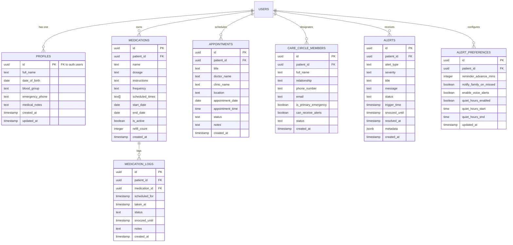

# CareCircle 🩺

> **"Your Health. Your Independence. Our Care."**

CareCircle is an elderly-first healthcare web companion designed to bridge the gap between independent senior living and peace of mind for families and caregivers. By combining high-contrast accessible typography, voice guidance, proactive medication management, doctor appointment tracking, intelligent alert escalations, and routine health analytics, CareCircle empowers older adults to take charge of their daily health journey while keeping their loved ones informed.

[](LICENSE)
[](https://nextjs.org/)
[](https://react.dev/)
[](https://www.typescriptlang.org/)
[](https://tailwindcss.com/)
[](https://supabase.com/)
[](tests/)

---

## 📑 Table of Contents

1. [Project Overview](#1-project-overview)
2. [Problem Statement](#2-problem-statement)
3. [Key Features](#3-key-features)
4. [Project Development Journey (Phases 0–7)](#4-project-development-journey-phases-07)
5. [Technology Stack](#5-technology-stack)
6. [Architecture & Workflow](#6-architecture--workflow)
7. [Folder Structure](#7-folder-structure)
8. [Prerequisites](#8-prerequisites)
9. [Installation & Local Setup](#9-installation--local-setup)
10. [Environment Variables](#10-environment-variables)
11. [Supabase Database & Schema Design](#11-supabase-database--schema-design)
12. [Feature Deep-Dive](#12-feature-deep-dive)
13. [Authentication, Authorization & Security](#13-authentication-authorization--security)
14. [Testing & Quality Assurance](#14-testing--quality-assurance)
15. [Running Locally](#15-running-locally)
16. [Deployment Guide (Vercel)](#16-deployment-guide-vercel)
17. [Troubleshooting](#17-troubleshooting)
18. [Healthcare Safety & Truthful Functionality](#18-healthcare-safety--truthful-functionality)
19. [Limitations & Future Scope](#19-limitations--future-scope)
20. [Contributing](#20-contributing)
21. [License & Acknowledgements](#21-license--acknowledgements)

---

## 1. Project Overview

CareCircle is built from the ground up prioritizing **senior accessibility, cognitive clarity, and patient privacy**. Many modern health applications are cluttered with micro-interactions, low-contrast text, confusing menus, and aggressive notifications that induce anxiety rather than confidence.

CareCircle inverts this paradigm:
- **Calm, High-Contrast Light Theme:** Warm ivory surfaces (`#F8FAF8`), deep charcoal green text (`#26352E`), and reassuring sage green accents (`#477A62`).
- **Generous Touch Targets:** All interactive controls guarantee touch targets $\ge 44\text{px} \times 44\text{px}$ (often $\ge 48\text{px}$ to $52\text{px}$ on mobile).
- **Audio Read-Aloud:** Native browser Speech Synthesis reads schedules and instructions aloud for seniors with visual impairments or fatigue.
- **Two-Way Reassurance:** Seniors maintain full control over their routine; family members and caregivers stay informed without intrusive surveillance.

---

## 2. Problem Statement

1. **Medication Non-Adherence in Seniors:** The World Health Organization estimates that 50% of patients with chronic diseases do not take medications as prescribed. For elderly adults managing multimorbidity, confusing schedules and memory slips lead to preventable hospitalizations.
2. **Caregiver Anxiety & Cognitive Burnout:** Adult children and family caregivers frequently worry about whether their aging parents took vital doses or attended specialist visits, leading to friction and repeated phone check-ins.
3. **Inaccessible Healthcare UIs:** Existing portal applications suffer from tiny fonts, tiny checkboxes, unintuitive modals, and dark mode clutter that seniors struggle to operate.
4. **Data Isolation Gaps:** Digital health tools often fail to enforce strict patient boundaries at the database level, creating compliance and privacy risks.

---

## 3. Key Features

- 🌅 **My Day Dashboard:** Daily chronological timeline grouping morning, afternoon, evening, and night doses with single-tap "Taken", "Undo", and "Snooze" actions.
- 💊 **Medication Management:** Complete CRUD interface with dosage, instructions, routine slot detection, refill tracking, and persistent dose history.
- 📅 **Doctor Appointments:** Comprehensive appointment scheduling with specialist categorization, clinic location, notes, and countdown indicators.
- 👨‍👩‍👧 **Family Care Circle:** Management of trusted emergency contacts and family liaisons with click-to-call (`tel:`) support and access revocation controls.
- 🔔 **Smart Alerts & Escalation:** Automated detection of overdue doses and upcoming clinical visits, customizable reminder lead times, and assistance requests ("Need Help").
- 📊 **Health & Routine Analytics:** Adherence rates calculated over 7-day, 30-day, and 90-day windows, consecutive streaks, and printable clinical summary reports.
- 🤝 **Caregiver Oversight Portal:** Authenticated caregiver dashboard allowing family members to monitor prescriptions, upcoming clinic visits, and care circle members.
- 🔊 **Voice Read-Aloud Guidance:** Accessible Speech Synthesis that verbalizes today's medication routine at the touch of a button.

---

## 4. Project Development Journey (Phases 0–7)

CareCircle was engineered following a strict **phase-by-phase, test-driven pull request workflow**:

| Phase | Title | Core Objective | Key Deliverables & Artifacts |
| :--- | :--- | :--- | :--- |
| **Phase 0** | **Foundation & Audit** | Clean environment, dependencies, and configuration setup. | Next.js 16 App Router, React 19, Tailwind CSS 4, ESLint 9, strict TypeScript configuration. |
| **Phase 1** | **Elderly Dashboard** | "My Day" view, accessible UI primitives, read-aloud voice support. | Accessible Card, Button ($\ge 44\text{px}$), Badge, speech synthesis engine, and caregiver portal. |
| **Phase 2** | **Auth & Profiles** | Secure authentication and persistent patient healthcare profiles. | Supabase Auth SSR, `public.profiles` table, signup database trigger, protected route middleware. |
| **Phase 3** | **Medication CRUD** | Persistent medication scheduling and daily dose logs. | `public.medications`, `public.medication_logs`, dose state machine (Taken/Undo/Snooze), RLS policies. |
| **Phase 4** | **Care Circle & Appts** | Family emergency contacts and doctor appointment management. | `public.care_circle_members`, `public.appointments`, click-to-call emergency links, appointment statuses. |
| **Phase 5** | **Smart Alerts** | Proactive overdue detection and assistance escalation. | `public.alerts`, `public.alert_preferences`, snooze windows, assistance request dispatch simulation. |
| **Phase 6** | **Analytics & Polish** | Warm light healthcare redesign and honest adherence metrics. | Sage light theme (`#F8FAF8`), `/analytics` with 7d/30d/90d filters, division-by-zero protection. |
| **Phase 7** | **E2E QA & Release** | Full end-to-end audit, cross-patient RLS verification, docs. | 110/110 passing automated tests, `README.md`, `CONTRIBUTING.md`, `.env.example`, production release. |

---

## 5. Technology Stack

- **Framework:** [Next.js 16.4.6](https://nextjs.org/) (App Router, Server & Client Components)
- **Library:** [React 19.3.0](https://react.dev/)
- **Language:** [TypeScript 5](https://www.typescriptlang.org/) (Strict Mode)
- **Styling:** [Tailwind CSS 4.3.3](https://tailwindcss.com/)
- **Database & Auth:** [Supabase](https://supabase.com/) (PostgreSQL 15+, Row Level Security, Auth SSR)
- **Icons:** [Lucide React 1.73.0](https://lucide.dev/)
- **Utility Libraries:** `clsx`, `tailwind-merge`
- **Testing Engine:** Node.js native test runner (`node --test`)
- **Linting & Formatting:** ESLint 9 with Next.js Core Web Vitals config
- **Deployment Platform:** [Vercel](https://vercel.com/)

---

## 6. Architecture & Workflow

### High-Level System Architecture



### Data Flow & Patient Isolation

1. **Authentication:** The user logs in via `/login`. Supabase Auth issues a secure JWT cookie handled by `@supabase/ssr`.
2. **Middleware Evaluation:** `src/lib/supabase/middleware.ts` intercepts requests. Unauthenticated requests to protected routes (`/my-day`, `/medications`, etc.) are redirected to `/login?redirect=<target>` with open redirect sanitization.
3. **Database Queries:** All client queries invoke Supabase RPC / PostgREST carrying the patient's JWT.
4. **Row Level Security (RLS):** PostgreSQL checks `auth.uid() = patient_id`. If Patient A queries Patient B's data, PostgreSQL returns zero rows, preventing cross-tenant leakage.

---

## 7. Folder Structure

```
CareCircle/
├── .env.example                     # Environment template with clean placeholders
├── .gitignore                       # Git ignore rules (protects .env.local, .next)
├── AGENTS.md                        # Next.js agent operational rules
├── CONTRIBUTING.md                  # Contribution and PR guidelines
├── LICENSE                          # MIT open source license
├── next.config.ts                   # Next.js configuration (Webpack, CPU optimizations)
├── package.json                     # Project manifest and npm scripts
├── public/                          # Static assets
│   ├── images/                      # Optimized application images (doctor-welcome.jpg)
│   └── ...
├── src/
│   ├── app/                         # Next.js App Router
│   │   ├── alerts/page.tsx          # Smart Alerts & Notification preferences
│   │   ├── analytics/page.tsx       # Health Analytics & clinical summary report
│   │   ├── appointments/page.tsx    # Appointment scheduling & management
│   │   ├── care-circle/page.tsx     # Family Care Circle contacts & emergency links
│   │   ├── caregiver/page.tsx       # Authenticated family oversight caregiver portal
│   │   ├── globals.css              # Light healthcare design tokens & CSS resets
│   │   ├── layout.tsx               # Root layout (Navbar, Footer, Font definitions)
│   │   ├── login/page.tsx           # Accessible 2-column login experience
│   │   ├── medications/page.tsx     # Medication CRUD & dose history
│   │   ├── my-day/page.tsx          # Daily elderly dashboard & voice guidance
│   │   ├── page.tsx                 # Root router (redirects to /my-day or /login)
│   │   ├── profile/page.tsx         # Patient health profile & emergency info
│   │   └── register/page.tsx        # Accessible patient registration
│   ├── components/
│   │   ├── dashboard/               # Dashboard widgets (AdherenceWidget, Timeline)
│   │   ├── layout/                  # Navigation bar, Footer, Mobile Drawer
│   │   └── ui/                      # Core primitives (Button, Card, Badge, Input)
│   ├── hooks/
│   │   ├── use-auth.ts              # Supabase authentication session state hook
│   │   └── use-speech.ts            # Speech synthesis read-aloud hook
│   ├── lib/
│   │   ├── supabase/                # Supabase client, server, and middleware helpers
│   │   └── utils.ts                 # Classname merge utility (cn)
│   └── types/
│       └── index.ts                 # TypeScript domain entities & database models
├── supabase/
│   └── migrations/                  # Chronological PostgreSQL SQL migrations
│       ├── 20261115_create_profiles.sql
│       ├── 20261115_create_medications.sql
│       ├── 20261115_create_care_circle_and_appointments.sql
│       └── 20261115_create_alerts.sql
└── tests/                           # Automated test suites (Node.js test runner)
    ├── auth-security.test.mjs
    ├── medications.test.mjs
    ├── phase4.test.mjs
    ├── phase5.test.mjs
    ├── phase6.test.mjs
    └── phase7.test.mjs
```

---

## 8. Prerequisites

Before installing CareCircle locally, ensure you have:
- **Node.js:** v18.18.0 or later (Node v20.x or v22.x LTS recommended).
- **npm:** v9.x or v10.x.
- **Git:** Installed and configured.
- **Supabase Account:** Free tier at [supabase.com](https://supabase.com/).
- **Modern Web Browser:** Chrome, Firefox, Edge, or Safari with Web Speech API support.

---

## 9. Installation & Local Setup

### Step 1: Clone the Repository
```bash
git clone https://github.com/Cassion478/CareCircle.git
cd CareCircle
```

### Step 2: Install Dependencies
```bash
npm install
```

### Step 3: Configure Environment Variables
Copy the example file to `.env.local`:

**PowerShell (Windows):**
```powershell
Copy-Item .env.example .env.local
```

**Bash (macOS / Linux):**
```bash
cp .env.example .env.local
```

Open `.env.local` and add your Supabase credentials:
```env
NEXT_PUBLIC_SUPABASE_URL=https://your-project-ref.supabase.co
NEXT_PUBLIC_SUPABASE_PUBLISHABLE_KEY=your-supabase-publishable-key
```

### Step 4: Apply Database Migrations in Supabase
Log in to your [Supabase Dashboard](https://supabase.com/dashboard) $\rightarrow$ Select your project $\rightarrow$ Open **SQL Editor**.

Run the migration scripts in numerical order:
1. `supabase/migrations/20261115_create_profiles.sql`
2. `supabase/migrations/20261115_create_medications.sql`
3. `supabase/migrations/20261115_create_care_circle_and_appointments.sql`
4. `supabase/migrations/20261115_create_alerts.sql`

Each will respond with: `Success. No rows returned`.

### Step 5: Start Development Server
```bash
npm run dev
```
Open [http://localhost:3000](http://localhost:3000) in your browser.

---

## 10. Environment Variables

| Variable | Description | Exposure | Required |
| :--- | :--- | :--- | :--- |
| `NEXT_PUBLIC_SUPABASE_URL` | REST endpoint URL for your Supabase project instance | Public (Client & Server) | **Yes** |
| `NEXT_PUBLIC_SUPABASE_PUBLISHABLE_KEY` | Supabase API publishable or anon key protected by RLS | Public (Client & Server) | **Yes** |
| `NEXT_PUBLIC_SUPABASE_ANON_KEY` | Optional legacy fallback key alias | Public (Client & Server) | No |

> 🔒 **Security Notice:** Never supply your Supabase `service_role` key in `.env.local` or client-facing code. The application relies entirely on Row Level Security (RLS) with user JWT tokens.

---

## 11. Supabase Database & Schema Design

### Entity-Relationship Diagram



### Table Overview & Security Policies

1. **`public.profiles`**: Extends `auth.users`. Handled automatically upon signup via a `SECURITY DEFINER` trigger with `search_path = public`. RLS enforces `auth.uid() = id`.
2. **`public.medications`**: Prescriptions and routines. RLS restricts `SELECT`, `INSERT`, `UPDATE`, and `DELETE` strictly to `auth.uid() = patient_id`.
3. **`public.medication_logs`**: History of taken, snoozed, and recorded doses. Indexed by `(patient_id, scheduled_for)`.
4. **`public.appointments`**: Specialist visits and follow-ups. Statuses: `scheduled`, `completed`, `cancelled`.
5. **`public.care_circle_members`**: Trusted family and caregiver contacts with emergency designation flags.
6. **`public.alerts`**: In-app notifications generated for upcoming doses, overdue reminders, and appointments.
7. **`public.alert_preferences`**: Patient reminder preferences and quiet hour settings.

---

## 12. Feature Deep-Dive

### 🌅 "My Day" Dashboard (`/my-day`)
- Chronologically groups scheduled doses into four intuitive daily routine buckets: **Morning** (06:00–11:59), **Afternoon** (12:00–16:59), **Evening** (17:00–21:59), and **Night** (22:00–05:59).
- Single-tap **"Mark Taken"** records the exact timestamp in `medication_logs`.
- Accidental taps can be reversed instantly with **"Undo"**.
- Built-in **"Snooze 10m"** defers the dose safely for 10 minutes.
- **Voice Read-Aloud:** Reads all pending items aloud via the browser Web Speech API.

### 💊 Medication Management (`/medications`)
- Add, edit, or discontinue medications.
- Configure multiple daily time slots (e.g. 08:00, 14:00, 20:00).
- Tracks refills remaining and end-dates to prevent expired courses.

### 📅 Doctor Appointments (`/appointments`)
- Visual cards displaying doctor name, specialty, date, and 12-hour formatted time.
- Integrated clinic location and notes fields for test preparation.
- Status filters: All, Upcoming, and Completed.

### 👨‍👩‍👧 Family Care Circle (`/care-circle`)
- Dedicated directory for adult children, spouses, and home health aides.
- Instant click-to-call links via mobile `tel:` protocol.
- Revocation controls allowing patients to suspend contact access anytime.

### 🔔 Smart Alerts & Escalation (`/alerts`)
- Surfaces proactive notices for pending medications and upcoming doctor visits.
- **"Need Help" In-App Assistance:** Allows seniors to log an in-app assistance request linked to their preferred family contact with one-tap phone dialing (`tel:` protocol). Does not dispatch external SMS, carrier texts, or 911/112 services.
- **10-Minute Snooze & Resolution:** Defers alerts by 10 minutes or marks them resolved to keep the dashboard tidy.

### 📊 Health & Routine Analytics (`/analytics`)
- Adherence calculation over customizable windows: **7 Days**, **30 Days**, and **90 Days**.
- **Truthful Empty State:** When 0 doses are scheduled or recorded, the system accurately displays *"No data available"* with a *"Not enough data"* badge (never a deceptive 100%).
- Consecutive streak tracking and one-click printable clinical summary report.

### 🤝 Caregiver Oversight Portal (`/caregiver`)
- Authenticated caregiver oversight interface (`/caregiver`) for family members and authorized caregivers.
- Protected by edge middleware; queries the authenticated user's prescriptions and clinical appointments.

---

## 13. Authentication, Authorization & Security

1. **Session Management:** Secure cookie-based authentication powered by `@supabase/ssr`. Tokens are refreshed automatically without client-side exposure of refresh tokens.
2. **Route Protection:** Server middleware protects `/my-day`, `/medications`, `/appointments`, `/care-circle`, `/alerts`, `/analytics`, `/caregiver`, and `/profile`. Unauthenticated visitors to `/` are directed to `/login`.
3. **Open Redirect Sanitization:** Redirect targets in `?redirect=` parameters are strictly sanitized:
   ```typescript
   function sanitizeRedirectUrl(url: string | null): string {
     if (!url) return "/my-day";
     if (url.startsWith("/") && !url.startsWith("//") && !url.includes("://") && !url.includes("\\")) {
       return url;
     }
     return "/my-day";
   }
   ```
4. **Row Level Security (RLS):** Every query against Supabase evaluates PostgreSQL RLS rules. No patient can read, insert, update, or delete records belonging to another UUID.

---

## 14. Testing & Quality Assurance

CareCircle includes an automated test suite executed via Node.js native test runner:

```bash
# Run all automated test suites
npm test

# Run specific phase test suite
node tests/phase7.test.mjs

# Verify strict TypeScript types
npm run typecheck

# Verify ESLint rules
npm run lint

# Verify full production build & static export
npm run build

# Check Git diff for whitespace or EOF defects
git diff --check
```

### Test Suite Results

```
Total Test Suites: 27
Total Automated Tests: 110 Passing, 0 Failing, 0 Skipped
TypeScript Errors: 0
ESLint Errors/Warnings: 0
Static Routes Generated: 14/14
```

---

## 15. Running Locally

### Development Mode
```bash
npm run dev
```
Navigate to `http://localhost:3000`.

### Production Build & Preview
```bash
npm run build
npm start
```
Starts the production Next.js server locally on port 3000.

---

## 16. Deployment Guide (Vercel)

CareCircle is configured for zero-configuration continuous deployment with [Vercel](https://vercel.com/):

1. **Push to GitHub:** Push changes to your `main` branch.
2. **Import Project:** Connect your GitHub repository in Vercel.
3. **Configure Environment Variables in Vercel:**
   - `NEXT_PUBLIC_SUPABASE_URL` = Your Supabase Project URL
   - `NEXT_PUBLIC_SUPABASE_PUBLISHABLE_KEY` = Your Supabase Publishable Key
4. **Deploy:** Vercel automatically runs `next build --webpack` and deploys the optimized application across edge locations.

---

## 17. Troubleshooting

### 1. `EPERM: operation not permitted, mkdir` on Windows
- **Cause:** Local file lock by Antivirus or parallel Node worker on Windows.
- **Solution:** Delete the `.next` folder and rerun:
  ```powershell
  Remove-Item -Recurse -Force .next
  npm run build
  ```

### 2. "Authentication redirect loop or session not found"
- **Cause:** Supabase cookie domain mismatch or unapplied profiles migration.
- **Solution:** Verify `NEXT_PUBLIC_SUPABASE_URL` in `.env.local` and confirm that `supabase/migrations/20261115_create_profiles.sql` was executed in the Supabase SQL editor.

### 3. "Adherence displays 0% or No data available"
- **Cause:** Normal behavior for new patient accounts with zero recorded dose history. Mark one or more doses as "Taken" in `/my-day` to generate your first adherence score.

---

## 18. Healthcare Safety & Truthful Functionality

CareCircle is built adhering to strict healthcare ethics:
- ❌ **No Automatic "Missed" Stigmatization:** Pending or snoozed doses are never prematurely branded as missed.
- ❌ **No Prescription Dosage Changes:** The application never advises doubling doses or altering prescribed quantities.
- ❌ **No False Dispatch Claims:** CareCircle does not claim to dispatch 911/emergency services or send automated SMS/carrier texts without configured external gateways.
- 📞 **Direct Dial Emergency Support:** All emergency contacts feature direct `tel:` protocol links allowing users to place calls via their native phone dialer.

---

## 19. Limitations & Future Scope

- **Push Notifications:** Currently, smart alerts and reminder notifications operate within the web application. Native push notifications (Web Push API / APNs) are planned for future iterations.
- **Pharmacy Refill Integration:** Refill counters are currently tracked manually by the user or family caregiver. Integration with pharmacy APIs (e.g. Surescripts) is a roadmap goal.
- **Wearable Health Sync:** Future scope includes integrating Bluetooth vitals (pulse oximeters, blood pressure monitors) via Apple HealthKit and Google Health Connect.

---

## 20. Contributing

We welcome contributions! Please review [CONTRIBUTING.md](CONTRIBUTING.md) for details on code standards, branch naming, and pull request guidelines.

---

## 21. License & Acknowledgements

CareCircle is open-source software licensed under the **[MIT License](LICENSE)**.

- **Author:** Siddharth Shukla
- **Design Principles:** Inspired by the WHO Age-Friendly Primary Health Care guidelines.
- **Icons:** [Lucide React](https://lucide.dev/)
- **Typography:** Inter by Rasmus Andersson.
